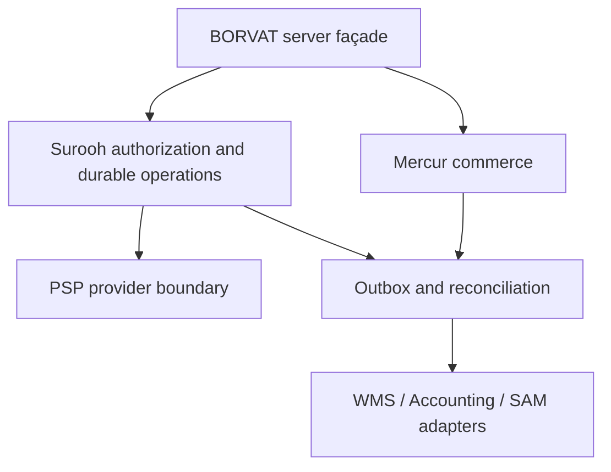

# Proposed Mercur/Surooh boundary — foundation hardening

Status: design baseline for review, not application cutover. Mercur 2.3.7 / Medusa 2.21.2 remain the candidate pair. The owner accepted research and Mercur as preferred candidate, not final adoption, merge, deployment or Codex.

| Domain | Native anchor | Surooh responsibility / invariants |
|---|---|---|
| Buyer identity | Medusa customer actor; existing Supabase identity retained pending bridge | Verify subject/issuer/audience server-side; explicit buyer-to-order ownership; no browser service credential |
| Seller | Mercur Seller/Member/SellerMember | Approved legal entity registry and KYB/trader evidence; seller staff/operator policy resolver; revoke membership before queued commands; tenant IDs are not legal company IDs |
| Product/variant | Medusa Product/Variant + Mercur product edit/review layer | Canonical merchandising identity, deduplication and restricted-goods rules; immutable external ID map, moderation and source provenance |
| Seller offer | Mercur Offer + linked price/inventory models | Seller-specific SKU/condition/price/availability; one chosen offer per variant and one seller per checkout enforced on server; do not assume variant SKU equals seller SKU |
| Cart/quote/order | Medusa Cart/Order and Mercur order-group/seller split | Server-authoritative price/currency/tax/delivery snapshots; immutable accepted quote hash and state transition policy; commercial order owner remains Marketplace |
| Commission | Mercur rate/rule/line engine | Versioned commercial fee policy and allocation facts. Accounting validates and posts the fee invoice/journal; it must not independently invent another commercial commission calculation |
| Payment/settlement | Native provider boundary and payout hooks only behind a reviewed adapter | Surooh durable operation/outbox/inbox with stable business idempotency, evidence, recovery and reconciliation. Native payout path currently fails H06 and cannot be exposed as a safe default |
| Fulfillment | Native fulfillment presentation and projected stock | WMS owns physical quantities/reservation/pick/pack/dispatch/return disposition. Avoid two independently authoritative reservation ledgers |
| Returns/refunds | Native return/claim models and seller scoping | Consumer workflow/eligibility, item allocation and durable refund intent; receiving stock does not prove refund or payout reversal. Refund replay/after-payout saga still requires native adapter tests |
| Audit/reporting/SAM | Native read models and events | Immutable service events plus tenant-safe projections. SAM reads or submits approved proposals; it cannot call raw module services, native submit/cancel/pay APIs or direct SQL |

Surooh additions stay in separate packages/service schemas with versioned ports. No core fork or new production backend is installed by this preparation. The proof schema is not the proposed full business database and must never be applied to Mercur/Supabase production. Native schema changes/upgrades need a pinned migration manifest and restore rehearsal, not a replay of historical SQL.

## Payment safety protocol

1. Validate authenticated ownership and the server quote. Commit immutable operation ID, merchant/order/buyer, amount/currency/hash, stable provider key and an append-only event before contacting the provider.
2. A worker claims a persisted operation with SKIP LOCKED, lease and fencing token; rechecks authorization; commits RECONCILE state **before** the external call. Queue payload IDs cannot set amount, merchant or authority.
3. Outside SQL transactions, look up the provider by the stable key. Only the first ready attempt may create a payment. Unknown historical outcomes with no authoritative fact remain visible for manual reconciliation; never rotate the key or blindly recapture after provider idempotency/history expiry.
4. Validate provider account, mode, amount, currency and reference. Atomically confirm local order/operation and append evidence with lease fencing. SQL failure or worker death leaves the original intent; a new process reconciles it.
5. Signed timestamped webhooks enter a deduplicated inbox as hints. They cannot declare PAID directly. Reject changed-payload replays, foreign tenant bindings and stale events. Recover from current provider facts before finality.
6. Accounting receives confirmed provider movements with source IDs and immutable snapshots, posts once and returns voucher acknowledgement. An internal PAID demo status is not money in a bank account. No platform custody, live PSP or real transaction is assumed.

Implemented/tested only in the isolated Surooh proof: capture/unknown outcome, local SQL failure, process crash, competing workers, lease fencing, typed tenant/actor boundaries, signed/replayed hints and logical snapshot restore. NOT established: production payment provider semantics, native checkout/payout/refund wiring, distributed reconciliation with Accounting/WMS, refund/chargeback/settlement after payout or PITR. Native H06 remains a blocking counterexample.
